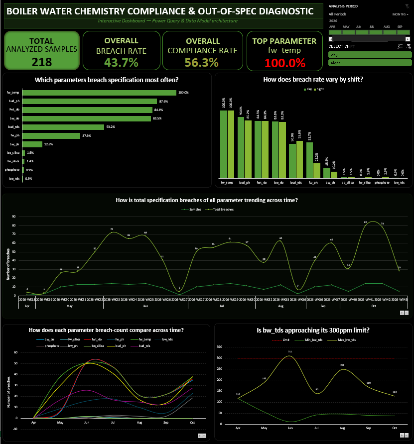
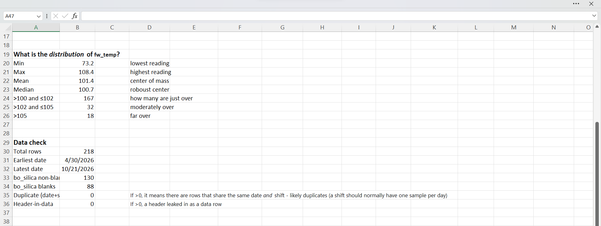
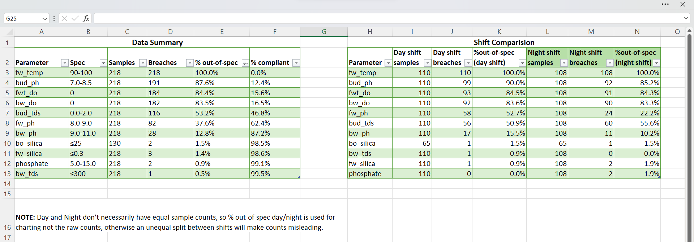

# Boiler Water Chemistry Compliance & Out-of-Spec Diagnostic

**A live Excel (Power Query + Power Pivot) monitoring dashboard that measures how often boiler and feed-water chemistry breaches plant specifications, and where the real problems sit. Append new shift readings to the source CSV, click Refresh All, and every flag, rate and chart recalculates.**


## Table of Contents
- [Business Problem](#business-problem)
- [Built for Continuous Monitoring](#built-for-continuous-monitoring)
- [Key Findings](#key-findings)
- [Recommendations](#recommendations)
- [Dashboard](#dashboard)
- [Data Source](#data-source)
- [Dataset](#dataset)
- [Parameter Specifications](#parameter-specifications)
- [Data Quality Notes](#data-quality-notes)
- [Methodology](#methodology)
- [Limitations](#limitations)
- [Future Improvements](#future-improvements)
- [How to Refresh the Dashboard](#how-to-refresh-the-dashboard)
- [Repository Structure](#repository-structure)
- [Author](#author)


## Business Problem
Boiler water chemistry outside specification accelerates corrosion, scale and carryover, which shortens equipment life and can cause unplanned downtime. When breaches are frequent but nobody has a ranked view of them, corrective effort is spread thinly and the genuinely high-risk chemistry is not prioritised.

This project answers four questions for plant operations and the water-treatment engineer:

1. Which parameters breach specification most often?
2. Do breach rates differ between day and night shifts?
3. When do breaches cluster in time?
4. Is boiler-water TDS approaching its 300 ppm limit?



## Built for Continuous Monitoring
This is not a one-off analysis of historical data. The dashboard is a continuous monitoring tool:

- **New data in, updated insight out.** Append new shift samples to the source CSV and click **Data → Refresh All**. Power Query reloads the data, DAX measures recalculate breach flags and rates, and all five PivotCharts, the KPI cards and the timeline update automatically.
- **Specifications are data, not formulas.** Bounds live in a separate `Specs` table, so a changed limit (for example `fw_temp 95-105`) recalculates the whole history without editing any formula.
- **Blank-safe by design.** Parameters that start being measured later (like `bo_silica`) are handled correctly, so new instruments or new tests can be added without breaking the rates.
- **Filter by time and shift.** A shared timeline and a shift slicer let operators move from a six-month view to a single week.

The findings below are a **snapshot as of 21 Oct 2026**. They will change as new readings are added; the repository's `docs/Findings_Summary_Plant_Manager.pdf` reflects that date.

## Key Findings
Snapshot based on **218 shift samples, 30 Apr – 21 Oct 2026** (110 day, 108 night; 119 distinct sampling dates).
| # | Finding | Evidence |
|---|---------|----------|
| 1 | **Overall, 43.7% of all readings were out of spec** (1,009 of 2,310 non-blank readings). | Breach rate is calculated on non-blank readings only, so the 88 blank `bo_silica` cells do not dilute it. |
| 2 | **Feed-water temperature breached on every sample (100%)**, but the pattern looks like a specification question, not a process failure. | 217 of 218 readings were above 100 °C. 76.6% sat between 100 and 102 °C (median 100.7 °C). 18 readings exceeded 105 °C. |
| 3 | **Dissolved oxygen changed behaviour on 27 May.** | Both DO readings were exactly 0.0 on every sample up to 26 May. From 27 May they were non-zero on nearly every sample (no zero readings at all June–September). `bw_do` and `fwt_do` breach 83.5% and 84.4% of the time and move together (correlation 0.75). |
| 4 | **Upper-drum chemistry is the most persistent genuine deviation.** | `bud_ph` breached 87.6%, and every breach was *below* the 7.0 lower limit (mean 5.88). `bud_tds` breached 53.2%, every breach *above* the 2.0 limit (max 9.0). |
| 5 | **Feed-water pH is the one parameter where shifts differ materially.** | `fw_ph` breached 52.7% on day shift vs 22.2% on night shift (Fisher exact test, p < 0.001). Of 82 breaches, 75 were below 8.0. All other parameters show similar rates across shifts. |
| 6 | **Boiler-water pH deteriorated in October.** | `bw_ph` breached on 50% of October samples (19 of 38) against 0–10% in May–September. Mean October pH was 8.73 against 9.3–9.8 in earlier months, recovering to 9.04 by the final week. |
| 7 | **Core boiler-water control was strong.** | `phosphate` 0.9%, `bw_tds` 0.5%, `fw_silica` 1.4%, `bo_silica` 1.5% breach rates. See [Data Quality Notes](#data-quality-notes) for caveats on how to read these. |

## Recommendations
1. **Review the `fw_temp` specification** against design intent before treating it as a failing parameter, and investigate the 18 readings above 105 °C.
2. **Cross-check the 27 May dissolved-oxygen change** against analyser calibration or replacement records and deaerator operation.
3. **Correct upper-drum chemistry** (`bud_ph` consistently low, `bud_tds` consistently high), including a review of blow-down frequency.
4. **Investigate the day/night difference in feed-water pH** (52.7% vs 22.2%): dosing practice, sampling timing or handover.
5. **Watch boiler-water pH** after the October dip and confirm the late-October recovery holds.

## Dashboard
Five linked PivotCharts, Four KPI cards, a shared timeline and a shift slicer.

| Question | Visual | Why this visual |
|----------|--------|-----------------|
| Which parameters breach most often? | Ranked horizontal bar | Long parameter names stay readable and rank order is immediate. |
| How does the breach rate vary by shift? | Clustered bar (% out-of-spec) | Rates, not raw counts, because day and night sample counts are unequal (110 vs 108 overall, and different per parameter for `bo_silica`). |
| When do breaches cluster? | Weekly line (samples vs breaches) | Shows timing and volume together. |
| How does each parameter trend? | Multi-line by parameter | Shows which parameters drive the weekly pattern. |
| Is `bw_tds` approaching 300 ppm? | Min/max line with limit line | Shows headroom to the limit. |

## Data Source
Primary data transcribed manually from internal plant shift logbooks (April–October 2026). To protect operational privacy, no sensitive company identifiers, equipment serial numbers, or location data are included in this repository. The dataset is provided for analytical demonstration purposes only.

## Dataset
`data/Boiler_Water_Analysis.csv` — 218 rows × 13 columns, one row per shift sample. Units are not stored in the CSV itself; they come from the plant data dictionary in `data/Data_Dictionary.csv`. pH is dimensionless.

| Column | Meaning | Notes |
|--------|---------|-------|
| `Shift` | `day` or `night` | |
| `report_date` | Sample date (M/D/YYYY) | One sample per shift per date; no duplicate date + shift combinations |
| `phosphate` | Boiler-water phosphate (ppm) | |
| `bw_ph` | Boiler-water pH | |
| `bw_do` | Boiler-water dissolved oxygen (ppm) | |
| `bw_tds` | Boiler-water total dissolved solids (ppm) | |
| `fwt_do` | Feed-water dissolved oxygen (ppm) | |
| `fw_temp` | Feed-water temperature (°C) | |
| `fw_ph` | Feed-water pH | |
| `fw_silica` | Feed-water silica (ppm) | |
| `bo_silica` | Boiler-water silica (ppm) | **Blank before 27 Jun 2026** (88 blanks, 130 readings) |
| `bud_ph` | Boiler upper-drum pH (steam quality) | `bud_` = boiler upper drum |
| `bud_tds` | Boiler upper-drum TDS (ppm, steam quality) | |

## Parameter Specifications
Specifications from `data/Specifications.csv` are held in a separate `Specs` table that drives every flag in the model.

| Parameter | Specification | Parameter | Specification |
|-----------|---------------|-----------|---------------|
| `phosphate` | 5.0 – 15.0 | `fw_ph` | 8.0 – 9.0 |
| `bw_ph` | 9.0 – 11.0 | `fw_silica` | ≤ 0.3 |
| `bw_do` | 0 (non-detect) | `bo_silica` | ≤ 25 |
| `bw_tds` | ≤ 300 | `bud_ph` | 7.0 – 8.5 |
| `fwt_do` | 0 (non-detect) | `bud_tds` | 0.0 – 2.0 |
| `fw_temp` | 90 – 100 | | |

## Data Quality Notes
Checks performed: row count, date range, duplicate date + shift pairs (0), header rows leaked into data (0), blank counts, fw_temp value distributions.
The checks was done to finally confirm the cleaning process done in power query.


- **`bo_silica` starts on 27 Jun 2026.** Its 1.5% breach rate covers 130 readings, not 218. Both breaches (120 and 160) are the first two readings on 27 and 30 Jun; no later reading exceeded 25.
- **`phosphate` is almost constant.** 213 of 218 readings are exactly 6.7. This could reflect tightly controlled dosing or values carried forward in the logbook. The 0.9% breach rate is accurate against the data, but it should not be read as proof of fine-grained control until the logbook practice is confirmed.
- **`fw_silica` sits on its limit.** 171 of 218 readings (78%) are exactly 0.30, which is compliant but leaves no headroom. The three breaches were 0.35–0.40.
- **Dissolved-oxygen specification is "0".** Any detectable oxygen is a breach. The step change on 27 May is consistent with an instrument or procedure change, a deaerator problem, or a genuine process change; the data alone cannot say which.
- **`fw_temp` start-up reading.** The lowest value (73.2 °C, 31 Aug) followed a shutdown; there are no samples between 15 Aug and 31 Aug. It is retained and represents a start-up condition. Other readings were above upper spec limit which lead to suspect a stale operational specification which no longer applies to the plant, I calculated the fw_temp value distribution to guide the stake holders in setting a new operational range for the fw_temp.
- **Weekly chart labels.** The weekly axis is grouped Month → Week, so a week that spans a month boundary appears under both months.
- This project defines a **critical sample as 6 or more simultaneous breaches** (54 samples, 24.8%).

## Methodology
- **Ingestion:** Power Query handles date parsing, null handling and future appends.
- **Model:** Power Pivot with DAX measures. A reading is out-of-spec if it is below the lower bound or above the upper bound in the `Specs` table.
- **Breach rate:** `out-of-spec readings ÷ non-blank readings`. The denominator is the number of non-blank readings for that parameter, not total rows.
- **Overall breach rate:** `total breaches ÷ total non-blank readings` (1,009 ÷ 2,310 = 43.7%).
- **Shift comparison:** compares breach *rates* because sample counts differ between shifts.
- **Dynamic specs:** change a bound in the `Specs` table and every flag, rate and chart recalculates.

**Tools**: Excel, Power Query, Power Pivot (DAX), PivotCharts, Slicers, Timeline.*



## Limitations
- Breaches are associations only.
- Sampling is irregular (119 sampling dates across 175 days), so rates are per sample, not per day.
- Specifications are treated as fixed for the whole period.
- The findings are a point-in-time snapshot (to 21 Oct 2026); the live dashboard will move as data is added.

## Future Improvements
- Rebuild the entire project with Power Query and DAX measures in Power BI

## How to Refresh the Dashboard
Use this routine to keep the dashboard current as new shift readings are logged.

1. Open `dashboard/Boiler_Water_Analysis.csv`.
2. Append new rows to the source CSV (same column order) and overwrite the file.
   - Keep the column names, date format (M/D/YYYY) and `day`/`night` labels unchanged; leave a cell blank rather than typing 0 when a parameter was not measured.
4. Open `dashboard/Boiler_Water_Analysis_.xslx`
5. Click **`Data → Refresh All`** PivotTables, KPI cards and charts update from the refreshed model.
6. If a specification changes, edit the `Specs` table; all flags recalculate.

## Repository Structure
```
Boiler Water Chemistry Compliance & Out-of-Spec Diagnostic/

├── dashboard/
│   └── boiler water chemistry compliance & out_of_spec diagnostic.xlsx
├── data/
│   └── Boiler_Water_Analysis.csv
├── docs/
│   ├── Findings_Summary_Plant_Manager.pdf
│   └──
└── images/
│   ├── 01_dashboard_overview.png
│   ├── 02_trends.png
│   ├── 03_compliance_and_shift_tables.png
│   └── 04_fw_temp_distribution_and_data_checks.png
├── LICENCE
└── README.md
     
```
## Author
**Joel Chukwudi Okolie** Data Analyst

**GitHub:** https://github.com/joelokolie

**LinkedIn:** https//www.linkedin.com/in/joel-okolie

